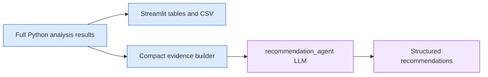

<div align="center">

# 💊 PharmaGuard AI
### Project Sankalp · Pharmaceutical Inventory & Claims Risk Intelligence

**A beginner-friendly guide to the exact LangGraph workflow, every node, state field, calculation, output, and dashboard**

  

  

</div>

> **Project purpose:** Help supply-chain and claims teams identify medicine expiry, stock shortages, surplus inventory, expiry-claim issues, redistribution friction, and unusual primary-sales patterns. The system analyzes CSV evidence and **suggests** investigation and action; it does not autonomously move medicines, settle claims, or approve payments.

> **Source accuracy:** This guide reflects the graph and state described in this project, plus the available source files for `claimsAnalysisDuplicateInvalid` (uploaded implementation under an alternate filename), `redistrutionRisk` (available implementation under `redistributionRisk.py`), `demandForecastRisk`, and Streamlit. Source files for some older inventory and downstream nodes were **not available for direct inspection**. Their roles are described using the graph and state contract you supplied; exact formulas must be verified in your local code. *Do not copy the illustrative examples as real company results.*

---

## 🧭 Table of contents

1. [The business problem](#-1-the-business-problem)
2. [Words to know](#-2-words-to-know)
3. [Your exact graph](#-3-your-exact-graph)
4. [Complete node-by-node guide](#-4-complete-node-by-node-guide)
5. [State fields: who writes and reads them](#-5-state-fields-who-writes-and-reads-them)
6. [How each analysis works](#-6-how-each-analysis-works)
7. [Combining, financial impact and AI recommendations](#-7-combining-financial-impact-and-ai-recommendations)
8. [The Streamlit dashboard](#-8-the-streamlit-dashboard)
9. [Run and test the application](#-9-run-and-test-the-application)
10. [Examples, warnings and troubleshooting](#-10-examples-warnings-and-troubleshooting)
11. [Limitations, safeguards and future work](#-11-limitations-safeguards-and-future-work)

---

## 🎯 1. The business problem

A pharmaceutical company may have **too much of a medicine at one C&F**, **too little at another**, or stock that may expire soon. In addition, expiry-return claims can require documentation checks and may take too long to settle. Planners also need to understand why primary invoicing varies from historical patterns.

**C&F** means *Carrying and Forwarding agent*: a distribution location that stores or handles medicines. **SKU** means *Stock Keeping Unit*: a unique medicine/product identifier. **Batch** means a manufacturing lot, often sharing an expiry date.

| Business question | Our analysis | Typical output |
|---|---|---|
| Which medicine batches may expire? | **Expiry** | Batch/location-level expiry risk |
| Where might inventory run out? | **Shortage** | Low-stock or low-coverage findings |
| Where is inventory higher than needed? | **Oversupply** | Excess-stock findings |
| Which expiry claims need investigation or follow-up? | **Claims** | Settlement delays, evidence exceptions, potential duplicates |
| Where does inventory appear stranded across locations? | **Redistribution** | Shortage/surplus overlap and *scenario-based* exposure |
| Where is primary invoicing hard to predict? | **Forecast** | Backtested forecast error by C&F, SKU and month |

**Remember:** The dashboard provides *decision support*, not automatic operational decisions.

## 📘 2. Words to know

| Term | Beginner explanation |
|---|---|
| **Node** | A Python function that completes one step in the workflow. |
| **Edge** | A connection telling LangGraph which node runs next. |
| **State (`PharmaState`)** | Shared dictionary-like data passed between nodes. |
| **Sequential** | Run one step after the previous step. |
| **Conditional routing** | Pick a path based on the user's selected analysis. |
| **Parallel** | Run multiple selected risk-analysis nodes in the same graph step. |
| **Deterministic Python** | Code applies defined rules; the result does not depend on LLM creativity. |
| **LLM** | Large Language Model; here it explains findings and proposes evidence-based actions. |
| **PTS** | Price to stockist, used by existing financial calculations where applicable. |
| **Primary sales** | Product invoicing into the trade channel, **not** necessarily final customer demand. |
| **Exposure** | A value potentially at risk; **not** necessarily a realized loss or savings. |
| **WAPE** | Weighted Absolute Percentage Error, a summary of forecast errors. |

## 🕸️ 3. Your exact graph

This diagram preserves **the node names and connections you supplied**. Allocation is intentionally absent.

```mermaid
flowchart TD
    S([START]) --> U[understand_query]
    U --> L[load_data]
    L --> V[validate_stock]
    V --> R{query_router}
    R -->|shortage| SH[shortage_risk]
    R -->|expiry| EX[expiry_risk]
    R -->|oversupply| OV[oversupply_risk]
    R -->|claims| CL[claim_risk]
    R -->|redistribution| RE[redistribution_risk]
    R -->|forecast| FC[demand_forecast_risk]
    R -->|unsupported| NO[unsupported_analysis]
    SH --> C[combine_results]
    EX --> C
    OV --> C
    CL --> C
    RE --> C
    FC --> C
    C --> FI[financial_impact]
    FI --> RA[recommendation_agent]
    RA --> FR[final_response]
    FR --> E([END])
    NO --> E
    classDef input fill:#DBEAFE,stroke:#2563EB,color:#1E3A8A;
    classDef risk fill:#DCFCE7,stroke:#16A34A,color:#14532D;
    classDef ai fill:#F3E8FF,stroke:#9333EA,color:#581C87;
    classDef caution fill:#FEF3C7,stroke:#D97706,color:#78350F;
    class U,L,V,R input;
    class SH,EX,OV,CL,RE,FC risk;
    class RA,FR ai;
    class NO caution;
```



**Execution sequence:** `understand_query → load_data → validate_stock → router → selected analysis branch(es) → combine_results → financial_impact → recommendation_agent → final_response`.

✅ **Sequential:** load and validate once.  
🟢 **Conditional:** `query_router` chooses the requested analyses.  
🟣 **Parallel:** several selected analysis nodes can run together.  
🟠 **LLM:** only the recommendation node is confirmed by shared code to call an LLM. Whether `final_response` does so must be checked in its local source.

**Important naming rule:** Streamlit and the router use selection keys `expiry`, `shortage`, `oversupply`, `claims`, `redistribution`, `forecast`. These are *not* identical to all graph node names. For instance, `claims` routes to `claim_risk`, and `forecast` routes to `demand_forecast_risk`. Using `claim` or `demand_forecast` as input can silently remove the selection if `understand_query` filters unsupported names.

---

## 🧩 4. Complete node-by-node guide

### 🔵 Node 1 — `understand_query`

**File:** `agent/understandQuery.py` · **Type:** Plain Python · **Job:** Check which analyses the user requested.

- **Reads:** `analysis_types` from Streamlit.
- **Does:** Keeps supported selection names; removes repeated or unsupported options.
- **Writes:** `analysis_types`.
- **Example:** `['expiry', 'claims', 'claims']` becomes `['expiry', 'claims']`.
- **Why it matters:** Prevents invalid or duplicate analysis paths. It does **not** interpret the question with an LLM in your shared implementation.

### 🔵 Node 2 — `load_data`

**File:** `agent/loadData.py` · **Type:** Python + existing CSV loader tools · **Job:** Load factual evidence.

- **Reads:** Files under the project's data location, through the existing loader functions.
- **Writes:** `stock`, `claims`, `sales`, `stockists`, `skus`, `batches`, `claim_emails`.
- **Does not do:** Predict demand, calculate settlement, or invent stock quantities.
- **Expected data:** See [input data](#input-data-and-their-fields).

### 🔵 Node 3 — `validate_stock`

**File:** `agent/validateStock.py` · **Type:** Deterministic Python · **Job:** Decide which stock records are safe to use for each inventory risk calculation.

- **Reads:** Primarily `stock` and `batches`.
- **Writes:** `valid_expiry_stock`, `valid_shortage_stock`, `valid_oversupply_stock`, `invalid_stock`, `validation_summary`.
- **Checks reported in shared code:** Numeric quantities, snapshot/expiry dates, identifiers, duplicate batch rows, batch-master consistency and monthly-demand consistency.
- **Result:** Valid record lists for each inventory risk, plus excluded records and reasons.
- **Why it matters:** Bad input can create false shortage, excess or expiry alerts.

**Note:** Claims and forecast are separate data domains; this stock validator does not establish that claim documents or sales records are valid.

### 🔷 Router — `query_router`

**File:** `agent/queryRouter.py` · **Type:** Conditional Python function · **Job:** Choose analysis nodes.

- **Reads:** `analysis_types`.
- **Returns route labels:** `expiry_risk`, `shortage_risk`, `oversupply_risk`, `claim_risk`, `redistribution_risk`, `demand_forecast_risk`, or `unsupported_analysis`.
- **Example:** `['claims', 'forecast'] → ['claim_risk', 'demand_forecast_risk']`.
- **Important:** Router and graph dictionaries must use the same route names. No `allocation_risk` route while Allocation is paused.

### 🟢 Node 4 — `expiry_risk`

**File:** `agent/expiryRisk.py` · **Type:** Python inventory analysis.

- **Reads:** `valid_expiry_stock` and other relevant master data **as implemented locally**.
- **Writes:** `expiry_risks`.
- **Purpose:** Identify stock at risk of expiring before it can be used/sold.
- **Example (illustrative only):** A medicine batch expires soon but has high remaining on-hand stock; flag it for investigation.
- **Result in UI:** Expiry table, risk-level filters and CSV download.

**Verification needed:** Exact expiry-risk threshold, consumption formula and severity bands were not available in inspected source; do not assume particular cutoffs without opening `agent/expiryRisk.py`.

### 🟢 Node 5 — `shortage_risk`

**File:** `agent/shortageRisk.py` · **Type:** Python inventory analysis.

- **Reads:** `valid_shortage_stock` and any local rule inputs.
- **Writes:** `shortage_results`.
- **Purpose:** Detect where available stock may be insufficient for expected outward demand.
- **Result:** Location/SKU shortage findings for the dashboard.

**Verification needed:** Exact lead-time, safety-stock and shortage formulas are determined by your local `agent/shortageRisk.py` and `agent/rules.py` if used.

### 🟢 Node 6 — `oversupply_risk`

**File:** `agent/oversupplyRisk.py` · **Type:** Python inventory analysis.

- **Reads:** `valid_oversupply_stock` and applicable local rules.
- **Writes:** `oversupply_risks`.
- **Purpose:** Identify potentially excessive inventory relative to observed outward movement.
- **Result:** Surplus-stock findings, location and SKU details.

**Verification needed:** Specific thresholds and formulas are not confirmed from the available file set.

### 🟢 Node 7 — `claim_risk` (expiry claims, settlement, duplicate/invalid)

**Local graph import:** `agent.claimsAnalysisDuplicateInvalid` · **Inspected implementation:** `claimsAnalysis_duplicate_invalid.py`, exporting `claim_risk = expiry_claims_analysis`.

- **Reads:** `claims`, `sales`, `batches`, `stockists`, `claim_emails` (also uses `analysis_date` and `claim_monitor_days` if supplied).
- **Writes:** `claim_results`, `settlement_results`, `duplicate_invalid_claims`, `claim_summary`, `claim_warnings`.
- **Filters:** Only `claim_type` = **Expired** or **Near expiry**.
- **Cross-checks:** Stockist, invoice lines, SKU, batch, quantity, claimed expiry, credit note and related emails.
- **Duplicate signals:** Repeated claim numbers or repeated combinations of stockist, SKU, batch, claimed quantity, invoice reference and claim type.
- **Invalid/incomplete signals:** Invoice/batch/quantity discrepancies, missing references and evidence contradictions.
- **Settlement:** Calculates elapsed days for credited claims when dates exist; ages pending cases against an as-of date. Pilot alert threshold: **45 days**.
- **Result:** Detailed claim rows, settlement exceptions, duplicate/invalid review list, counts and warnings.

**Not a decision engine:** A duplicate flag **does not prove fraud**. Missing documentation **does not automatically invalidate a claim**. A claim passing evidence checks is **not necessarily policy-approved**. Verify official claim windows and contractual SLA before enforcing them.

### 🟢 Node 8 — `redistribution_risk` (slow redistribution investigation)

**Local graph import:** `agent.redistrutionRisk` (spelling from your shared graph) · **Inspected implementation:** `redistributionRisk.py`.

- **Reads:** `stock`, `batches`, `skus`; optionally `valid_shortage_stock` and `valid_oversupply_stock`.
- **Writes:** `redistribution_results`, `redistribution_summary`, `redistribution_warnings`.
- **Does:** Uses the latest available stock snapshot; looks for an understocked **receiver C&F** and potential surplus of the same SKU elsewhere.
- **Scenario assumptions:** 14-day redistribution period, 30-day receiver target, 60-day donor reserve and 30 days per month for converting monthly movement to daily movement.
- **Result:** Affected C&F–SKU locations and *scenario-based* uncovered demand; filters questionable stock records.

**Critical:** The data has no actual transfer request/approval/dispatch/receipt log. This node **cannot measure actual transfer turnaround** and **does not make or authorize transfers**. It is different from Allocation, which remains paused.

### 🟢 Node 9 — `demand_forecast_risk`

**File:** `agent/demandForecastRisk.py` · **Type:** Deterministic Python historical backtest.

- **Reads:** `sales` (primary invoice records); optional `sku_code` and `cnf_code` filters.
- **Writes:** `forecast_results`, `forecast_summary`, `forecast_warnings`.
- **Method:** For each C&F/SKU/month, predict primary invoiced packs using the **previous three calendar months' average**; compare against actual invoices for recent completed months.
- **Measures:** Error in packs, absolute percentage error, **WAPE**, bias, error direction, high/critical error count and scheme-associated invoice share.
- **Pilot severity thresholds:** **High at 25%** and **Critical at 50%** absolute percentage error for nonzero actuals; separate handling when actuals are zero.
- **Result:** C&F × SKU × month comparisons, trend chart, downloadable CSV and caveats.

**Critical:** This is a *baseline versus primary invoicing*, **not** the company's official forecast accuracy and **not** final customer demand. Quarterly schemes may affect invoicing without proving a change in underlying demand.

### 🟠 Exception node — `unsupported_analysis`

- **Runs when:** The router has no supported analysis to execute.
- **Writes:** `error`.
- **Then:** Goes directly to `END`, without normal analysis/recommendations.

### 🟣 Node 10 — `combine_results`

**File:** `agent/combineResults.py` · **Type:** Plain Python aggregation.

- **Reads:** Selected analysis names plus the output lists for each selected branch.
- **Writes:** `inventory_findings`.
- **Current agreed design:** One item per selected risk with `risk_type`, `total_records`, and `results`.

```python
{
    "risk_type": "claims",
    "total_records": 2,
    "results": [{"claim_no": "EXAMPLE-1"}, {"claim_no": "EXAMPLE-2"}]
}
```

*Example data above is fabricated for teaching, not a real claim.*

**Important:** The recent six-analysis version combines `claim_results`, but **not necessarily** the separate `settlement_results` and `duplicate_invalid_claims`; these remain in state and should be included explicitly in the LLM's compact claim summary when needed. Combining full lists is acceptable for processing, **not** for sending directly to the LLM.

### 🟣 Node 11 — `financial_impact`

**File:** `agent/financialImpact.py` · **Function in your graph:** `calculate_financial_impact`.

- **Reads:** Existing risk results and PTS prices / `skus`, depending on your implementation.
- **Writes:** `financial_impact`.
- **Known dashboard contract:** `financial_impact['by_risk'][risk]['exposure_inr']` for `expiry`, `shortage`, `oversupply` where calculated.
- **Displays:** Expiry Exposure, Potential Sales at Risk, Excess Inventory Value.
- **Does not automatically do:** Financial calculations for Claims, Redistribution or Forecast merely because they are connected to `combine_results`.

**Verify locally:** Exact formulas, coverage and missing-PTS behavior in `agent/financialImpact.py`. Exposure is **not realized savings**.

### 🟪 Node 12 — `recommendation_agent` — the LLM node

**File:** `agent/recommendationAgent.py` · **Type:** LLM + Pydantic structured output.

- **Reads:** Selected analysis summaries, bounded sample evidence, and existing financial totals **after the recent token-limit fix**.
- **Writes:** `recommendations`, each with `risk_type`, `priority`, `issue`, `suggested_action`, `business_benefit`.
- **Reason for change:** Your previous prompt sent every combined record as `json.dumps(findings)`, resulting in a **806,635-token** request to a **128,000-token** model.
- **New principle:** Keep all rows for Python and Streamlit; send **only concise summaries and limited examples** to the LLM.
- **Safeguards:** No invented SKU/batch/amount/date, no automatic claims rejection or stock transfer, no fabricated benefits.

**LLM recommendations are suggestions** and should be reviewed by responsible business teams.

### 🟪 Node 13 — `final_response`

**File:** `agent/finalResponse.py` · **Type:** Final presentation/response assembly (inspect implementation to confirm any LLM use).

- **Likely reads:** `inventory_findings`, `recommendations`, `financial_impact` and error/warning fields as coded locally.
- **Writes:** `final_answer`.
- **Purpose:** Prepare the final human-readable result.
- **Safety:** If it uses an LLM, give it a **compact summary**, never the full state or all CSV records.

**Verification needed:** Exact implementation was not directly available to inspect.

---

## 🗃️ 5. State fields: who writes and reads them

Think of `PharmaState` as a **shared notebook**. Each node writes its output into a named section; later nodes can read it.

| Field(s) | Main producer | Main consumer |
|---|---|---|
| `user_query`, `analysis_types` | Streamlit input; `understand_query` updates selection | `understand_query`, `query_router`, aggregators |
| `stock`, `claims`, `sales`, `stockists`, `skus`, `batches`, `claim_emails` | `load_data` | Validator and risk nodes |
| `valid_expiry_stock`, `valid_shortage_stock`, `valid_oversupply_stock` | `validate_stock` | Corresponding inventory nodes; redistribution where used |
| `invalid_stock`, `validation_summary` | `validate_stock` | Streamlit Data Quality tab |
| `expiry_risks` | `expiry_risk` | `combine_results`, finance/UI |
| `shortage_results` | `shortage_risk` | `combine_results`, finance/UI |
| `oversupply_risks` | `oversupply_risk` | `combine_results`, finance/UI |
| `claim_results`, `settlement_results`, `claim_summary`, `claim_warnings`, `duplicate_invalid_claims` | `claim_risk` | Streamlit and compact recommendations |
| `redistribution_results`, `redistribution_summary`, `redistribution_warnings` | `redistribution_risk` | Streamlit and compact recommendations |
| `forecast_results`, `forecast_summary`, `forecast_warnings` | `demand_forecast_risk` | Streamlit and compact recommendations |
| `inventory_findings` | `combine_results` | Recommendations, downstream reports if configured |
| `financial_impact` | `calculate_financial_impact` | Streamlit, recommendations |
| `recommendations` | `recommendation_agent` | Streamlit, `final_response` |
| `messages` | Only nodes that explicitly use message history | LLM nodes if wired |
| `final_answer` | `final_response` | Caller/UI if displayed |
| `error` | `unsupported_analysis` or other error-producing nodes | Streamlit |
| `data_warnings` | Only if explicitly written by code | UI/agent if used |
| `sku_code`, `batch_no`, `cnf_code` | Optional request filters | Nodes that implement filters |

**Do not duplicate `recommendations` in `PharmaState`.** `allocation_findings`, `valid_allocation_stock`, and other Allocation-specific fields are dormant while the feature is disabled. Removing them is optional **only after checking that active code does not reference them**.

### Input data and their fields

These are the headers directly observed in the supplied CSV files:

| File | Important columns | Used for |
|---|---|---|
| `cnf_stock_snapshot.csv` | `snapshot_date`, `cnf_code`, `cnf_city`, `sku_code`, `batch_no`, `expiry_date`, `qty_on_hand_packs`, `avg_monthly_outward_packs` | Stock validation, inventory risk, redistribution |
| `batch_master.csv` | `batch_no`, `sku_code`, `mfg_date`, `expiry_date`, `batch_qty_packs` | Batch/expiry reference |
| `sku_master.csv` | `sku_code`, `product_description`, `pts_inr`, `mrp_inr`, `shelf_life_months` | Product lookup and valuation |
| `stockist_master.csv` | `stockist_code`, `cnf_code`, `city`, `state`, `gstin` | Claims, stockist-to-C&F link |
| `primary_sales.csv` | `invoice_no`, `invoice_date`, `cnf_code`, `stockist_code`, `sku_code`, `batch_no`, `invoiced_qty`, `scheme_code`, `net_value_inr` | Claim-invoice evidence, primary invoice forecast backtest |
| `expiry_claims(1).csv` | `claim_no`, `claim_date`, `stockist_code`, `sku_code`, `batch_no`, `qty_claimed`, `original_invoice_ref`, `status`, `credit_note_date` | Claim checks, settlement duration |
| `claim_emails.csv` | `email_id`, `received_date`, `stockist_code_by_mailbox_rule`, `subject`, `body` | Supporting correspondence |

> **Heads-up:** `primary_sales.csv` uses **`invoiced_qty`**, not `qty_packs`; `expiry_claims(1).csv` uses **`claim_no`** and **`qty_claimed`**, not `claim_id` and `claim_qty_packs`. Column names in your loader must match your actual files.

---

## 📐 6. How each analysis works

The examples below are **simplified teaching examples** unless labeled as exact implemented rules.

### A. Inventory expiry

**Question:** Could packs expire before they are consumed?  
**Typical inputs:** Quantity, expiry date, outward demand.  
**Output:** `expiry_risks` with locations/batches requiring attention.  
**Business action:** Verify current on-hand and eligibility; investigate returns or other approved actions.  
**Exact threshold:** Confirm from `expiryRisk.py`.

### B. Inventory shortage

**Question:** Is there enough stock to cover expected demand?  
**Typical inputs:** Available packs, historical outward movement, replenishment assumptions.  
**Output:** `shortage_results`.  
**Business action:** Review demand and replenishment with the responsible location.  
**Exact formula:** Confirm from `shortageRisk.py`.

### C. Inventory oversupply

**Question:** Is stock materially above expected needs?  
**Typical inputs:** Available packs, outward movement and any reserve rule.  
**Output:** `oversupply_risks`.  
**Business action:** Investigate slow-moving inventory and avoid further unnecessary shipments.  
**Exact formula:** Confirm from `oversupplyRisk.py`.

### D. Expiry claims and settlement — verified implemented logic

```text
Claims CSV
  → Select Expired / Near expiry
  → Match stockist, batch and invoice evidence
  → Detect repeated claim numbers / repeated claim details
  → Inspect claimed quantities and credit note details
  → Compute credited settlement duration / pending age
  → Produce claim_results, settlement_results, duplicate_invalid_claims
```

**Settlement formulas:**

- Credited case: `settlement_days = credit_note_date − claim_date`, where both dates exist.
- Pending case: `age_days = as_of_date − claim_date`, where valid.
- Pilot overdue alert: duration **over 45 days**. This is **not confirmed policy**.

**Examples of output:** `claim_summary.total_claim_rows`, `pending_rows`, `pending_over_threshold_rows`, `delayed_credited_rows`, `average_settlement_days`, `potential_duplicate_rows`.

### E. Redistribution delay — verified implemented scenario

```text
Latest stock snapshot
  → Compare C&F/SKU stock vs monthly outward movement
  → Identify potential receiver gap and another C&F's surplus
  → Estimate uncovered demand in a hypothetical 14-day period
  → Report affected locations and warnings
```

**Scenario parameters:** receiver target 30 days, donor reserve 60 days, month length 30 days, redistribution scenario 14 days.

**Teaching example:** If a location has 500 packs, needs 100 packs/day and waits a hypothetical 14 days, uncovered demand under those fixed assumptions is `max(0, 100 × 14 − 500) = 900 packs` **before considering any other replenishment**. That is not a measured loss.

### F. Demand forecast accuracy — verified implemented baseline

```text
Primary invoice records
  → Sum invoiced packs per C&F + SKU + month
  → Forecast a month from the three prior calendar months
  → Compare estimate with invoiced packs
  → Calculate errors, WAPE, bias and severity
  → Show month/SKU/location exceptions
```

- **Forecast:** `(previous month 1 + previous month 2 + previous month 3) ÷ 3`.
- **Error:** `baseline_forecast − actual_primary_invoiced`.
- **WAPE:** `100 × sum(abs(error)) ÷ sum(actual_primary_invoiced)` when total actual is positive.
- **Bias:** `100 × sum(error) ÷ sum(actual_primary_invoiced)` when total actual is positive.
- **High / Critical:** pilot absolute-percentage thresholds 25% / 50% for nonzero actuals.

**Teaching example:** Prior months 100, 120, 140 packs → baseline 120. This month invoices 150 → error `−30` packs and absolute percentage error `20%`. It is an invoice-backtest difference, **not proof of unmet customer demand**.

---

## 🤝 7. Combining, financial impact and AI recommendations

### Why `combine_results` exists

Each risk node returns its own result list. `combine_results` builds a consistent report envelope:

```python
{
    "inventory_findings": [
        {"risk_type": "expiry", "total_records": 10, "results": ["...details..."]},
        {"risk_type": "claims", "total_records": 25, "results": ["...details..."]}
    ]
}
```

**Illustrative structure only:** The counts and placeholder strings are not real results. `inventory_findings` can be very large because `results` contains the full records.

### Why `financial_impact` is separate

Python should calculate financial exposure based on data and rules; the LLM should **not invent amounts**. The current dashboard expects totals for the three existing inventory risks. Do not sum redistribution inventory values or claim amounts as savings without a verified business rule.

### Why the LLM must receive a summary instead of full data



The original agent directly serialized `inventory_findings` into an LLM message, causing a **context-length error (~806,635 requested tokens versus 128,000 supported)**. The revised approach sends bounded counts, summaries, and a few example rows instead. Full records still remain available to Streamlit.

**Structured recommendation fields:** `risk_type`, `priority` (HIGH/MEDIUM/LOW), `issue`, `suggested_action`, `business_benefit`. Supported types: `expiry`, `shortage`, `oversupply`, `claims`, `redistribution`, `forecast`.

---

## 🖥️ 8. The Streamlit dashboard

**File:** `streamlit_app.py` · **Entry point:** `workflow.invoke({'user_query': ..., 'analysis_types': [...]})`.

The available dashboard implementation shows:

| Section | What a stakeholder sees |
|---|---|
| **Select Inventory Risks** | Multi-select for six active analyses; Allocation intentionally hidden |
| **Inventory Overview** | Stock record count, validation issues, number of selected analyses, recommendation count |
| **Financial Risk Impact** | Three inventory exposure metrics where calculated; bar chart |
| **Expiry / Shortage / Oversupply** | Result tables, risk-level filters, CSV downloads |
| **Expiry Claims & Settlement** | Claim counts, pending/overdue settlement, duplicate/invalid review flags, exported exceptions |
| **Redistribution Delay** | Affected C&F/SKU pairs, hypothetical uncovered demand, assumptions and data-quality warnings |
| **Demand Forecast Accuracy** | WAPE, bias, high-error comparisons, monthly trend, export |
| **Recommendations** | LLM-generated structured action suggestions |
| **Data Quality** | Stock validation problems and downloadable invalid rows |

**Color key** used in risk tables (where a severity column exists):

- 🔴 **CRITICAL** — needs urgent investigation.
- 🟠 **HIGH** — important investigation.
- 🟡 **MEDIUM** — monitor and prioritize appropriately.
- 🟢 **LOW** — lower immediate attention.
- ⚪ **UNKNOWN** — severity missing/unknown.

Color is a display aid, **not a policy approval or proof of financial loss**.

---

## ▶️ 9. Run and test the application

### Expected project organization

```text
project-sankalp/
├── agent/
│   ├── graph.py
│   ├── state.py
│   ├── understandQuery.py
│   ├── queryRouter.py
│   ├── loadData.py
│   ├── validateStock.py
│   ├── expiryRisk.py
│   ├── shortageRisk.py
│   ├── oversupplyRisk.py
│   ├── claimsAnalysisDuplicateInvalid.py
│   ├── redistrutionRisk.py        # spelling in user's current import
│   ├── demandForecastRisk.py
│   ├── combineResults.py
│   ├── financialImpact.py
│   ├── recommendationAgent.py
│   ├── finalResponse.py
│   └── llm.py
├── data/                         # CSV files; loader paths must match
├── streamlit_app.py
└── README.md
```

**The directory tree is an intended layout based on imports**, not a verified listing of your local repository. The redistribution filename `redistrutionRisk.py` is spelled exactly as in your shared graph; rename the import and file together if you standardize it.

### Windows PowerShell

```powershell
# Activate your existing virtual environment (adjust its folder name)
.\.venv\Scripts\Activate.ps1

# Run automated tests
python -m pytest -q

# Start the UI
python -m streamlit run streamlit_app.py
```

Set up LLM API credentials in your **local `.env` or deployment secrets**, never in the README or committed files. Follow the existing `agent/llm.py` provider configuration; the exact required key names depend on your project setup.

### Quick test sequence

1. Select **Expiry only** → verify `expiry_risks` and its table.
2. Select **Claims only** → verify `claim_results`, `claim_summary`, duplicate/invalid review, settlement exceptions.
3. Select **Redistribution only** → confirm latest snapshot, scenario label and warnings.
4. Select **Forecast only** → verify `forecast_results`, summary, WAPE and trend.
5. Select **all six** → confirm the six analyses complete and the LLM recommendation request stays small.

**Do not put `workflow.invoke(...)` unguarded at the bottom of `agent/graph.py`**: Streamlit importing `workflow` would trigger an extra analysis. Put standalone tests in `debug_graph.py` or behind `if __name__ == '__main__':`.

---

## 🛠️ 10. Examples, warnings and troubleshooting

| Symptom | Likely place to inspect | First check |
|---|---|---|
| No results for Claims | `understandQuery.py`, `queryRouter.py` | Use selection key `claims`, not `claim` |
| No results for Forecast | Router and `state.py` | Use `forecast`, not `demand_forecast`; declare `forecast_*` fields |
| Financial amounts not shown | `financialImpact.py`, Streamlit | Check `financial_impact.by_risk.<risk>.exposure_inr` |
| API error: 128k limit | `recommendationAgent.py`, maybe `finalResponse.py` | Do **not** send full `inventory_findings` or `state` to LLM |
| Settlement marked delayed | Claims rule and reporting date | Check available credit-note date or as-of date; 45 days is a pilot threshold |
| Duplicate claim flagged | Claim evidence / matching | Review invoice, claim and batch; flag is not fraud proof |
| Redistribution amount looks like actual loss | `redistributionRisk.py` / Streamlit | It is a **14-day scenario** with no transfer log |
| Forecast error seems unexpected | `demandForecastRisk.py` | Compare with primary invoices; scheme codes may affect them |
| `ImportError` in redistribution | Local filename and graph import | `redistrutionRisk` vs `redistributionRisk` spelling |
| No recommendations | Recommendation agent and input context | Inspect compact summary and model errors |

### Assumptions versus data quality

**Assumption:** A chosen pilot rule, such as 45-day claims alert or 14-day redistribution scenario.  
**Data quality issue:** Missing, outdated or contradictory evidence, such as an invalid expiry date or missing claim invoice reference.

The dashboard displays warnings to help stakeholders interpret results correctly.

---

## 🛡️ 11. Limitations, safeguards and future work

### What is implemented / supported

- ✅ Existing graph routes to **six** active analyses.
- ✅ Deterministic, evidence-based checks for claims, redistribution screening, and forecast backtesting in the inspected files.
- ✅ Streamlit offers analysis tables, warnings and downloadable data.
- ✅ The revised recommendation design avoids passing entire datasets to the LLM.
- ✅ **Allocation remains disabled by choice**.

### What must not be misrepresented

- ⚠️ A flagged duplicate is **not** proof of fraud or duplicate payment.
- ⚠️ A 45-day alert is **not** a verified settlement SLA.
- ⚠️ The 14-day redistribution period is **not** measured transfer time.
- ⚠️ Forecast baseline WAPE is **not** official company forecast accuracy.
- ⚠️ Risk exposure is **not** actual financial loss or achieved savings.
- ⚠️ Recommendations are **not** authorization to transfer medicines or settle claims.

### Next development phases

1. Verify official claim/return policy terms and move approved thresholds into `agent/rules.py` with tests.
2. Add actual forecast submissions and secondary-sales data to distinguish forecast error from primary shipment distortion.
3. Add transfer request, approval, dispatch and receipt events to measure true redistribution turnaround.
4. Implement **Inventory Allocation** last, as planned, with approval and batch-eligibility safeguards.
5. Verify local implementations of `expiryRisk.py`, `shortageRisk.py`, `oversupplyRisk.py`, `financialImpact.py` and `finalResponse.py` against this README.

---

<div align="center">

### 🎓 How to explain this project in an interview

> “I built a LangGraph-based pharmaceutical risk-intelligence application. It loads and validates source data, routes selected risk checks through deterministic Python nodes, combines the results, calculates supported financial exposure, and uses an LLM only for concise, evidence-grounded recommendations. Streamlit displays detailed evidence and warnings. The application highlights exceptions for business review; it does not automate stock transfers or claim decisions.”

**Project Sankalp · PharmaGuard AI**  
*Data → Validation → Risk Analysis → Financial Exposure → Recommendations → Business Review*

</div>
